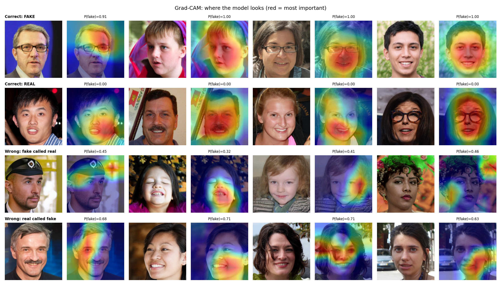
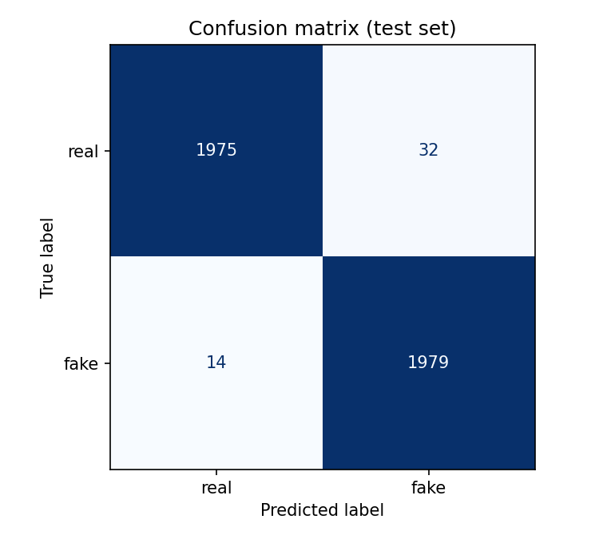
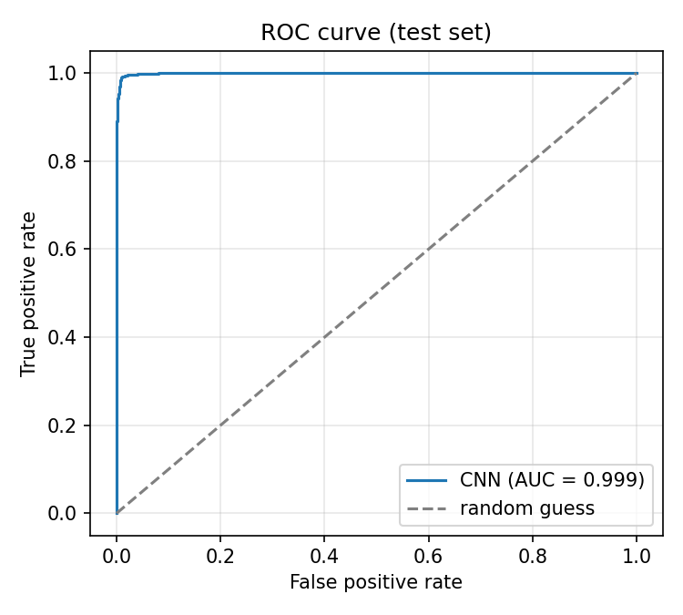
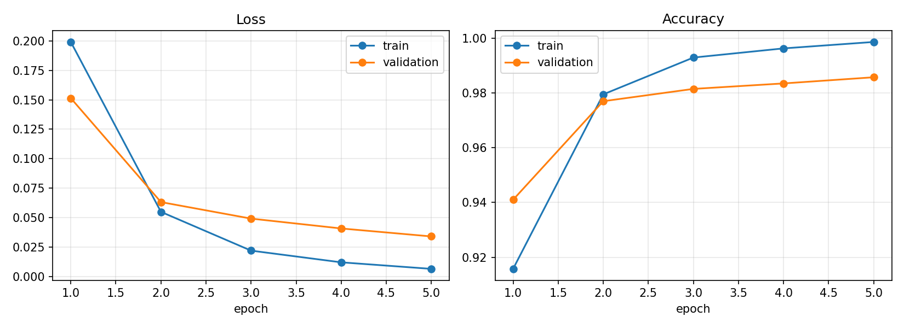
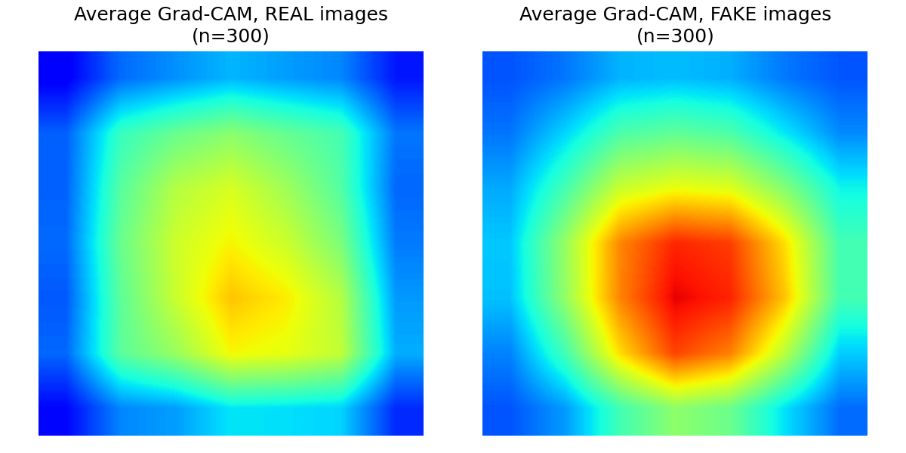
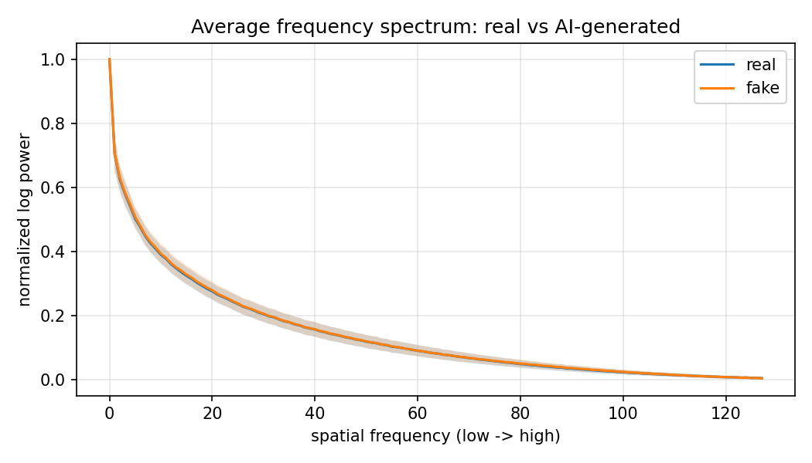

# Detecting AI-Generated Faces with CNNs and Grad-CAM

A computer-vision / machine-learning project that classifies face images as **real** or **AI-generated (StyleGAN)**, and explains *why* the model makes each decision.

**Result:** a fine-tuned ResNet18 reaches **98.85% accuracy** (ROC-AUC 0.999) on 4,000 unseen test images. A classical, non-deep-learning frequency baseline reaches only 60.9%. Grad-CAM shows the model focuses on the face and mostly ignores the background.



## Why this matters
Realistic AI-generated faces are used for fake social media profiles, scams and misinformation, and people are often bad at spotting them. A detector that also shows *where* it looks is more useful than a black box, because we can check whether it relies on the face itself or on some unrelated shortcut.

## Pipeline
```
face image ──► ResNet18 (ImageNet-pretrained, fine-tuned) ──► P(fake)
                              │
                              └──► Grad-CAM heatmap (why?)
```
- The dataset images are already face crops. For your own photos, `predict.py` first finds and crops the face with OpenCV (classical computer vision), then runs the model.
- Also included: a **classical CV baseline** that does not use deep learning (Fourier-spectrum features + logistic regression).

## Dataset
[140k Real and Fake Faces](https://www.kaggle.com/datasets/xhlulu/140k-real-and-fake-faces): 70k real faces (FFHQ / Flickr) and 70k StyleGAN-generated faces, already split into train / validation / test.

Random, balanced subsets were used because of limited compute:
- **CNN:** 20,000 train / 4,000 validation / 4,000 test images.
- **Frequency baseline:** 4,000 train / 2,000 test images.

## Training setup
- Model: ResNet18 pretrained on ImageNet (transfer learning), last layer replaced with one output (the "fake score").
- Loss: binary cross-entropy. Optimizer: AdamW (learning rate 1e-4) with cosine learning-rate decay.
- 5 epochs, batch size 64, light augmentation (horizontal flip, small brightness/contrast changes).
- Trained on a free Google Colab T4 GPU in about 10 minutes (about 2 minutes per epoch).
- The checkpoint with the best validation accuracy was kept (98.58%, reached in the last epoch).

## Results (test set)

| Model | Test images | Accuracy | F1 (fake) | ROC-AUC |
|---|---|---|---|---|
| FFT spectrum + logistic regression (classical) | 2,000 | 60.9% | 0.615 | 0.645 |
| ResNet18, fine-tuned | 4,000 | **98.85%** | **0.989** | **0.999** |

ResNet18 per class: precision 0.993 / recall 0.984 for real, precision 0.984 / recall 0.993 for fake. Errors are balanced between the two classes.

| Confusion matrix | ROC curve | Training curves |
|---|---|---|
|  |  |  |

Training accuracy (99.9%) ended slightly above validation accuracy (98.6%), so there is mild overfitting, but validation loss kept improving every epoch.

## Interpretability

**Grad-CAM** (implemented from scratch in [`src/gradcam.py`](src/gradcam.py)) shows which regions push the model toward its prediction. Red = most important.



Observations:
- **Where the model looks:** for fake images the model focuses strongly on the centre of the face (cheeks, nose and mouth area). For real images the attention is weaker and more spread out. For both classes the background and image corners get almost no attention on average, so the model is not mainly relying on the background.
- **Correct predictions** are confident (P(fake) close to 0 or 1) and the heatmap sits on the face.
- **Mistakes** were all low-confidence (P(fake) between 0.32 and 0.71), so the model was unsure rather than confidently wrong. In the "fake called real" examples I looked at, several images had accessories, busy backgrounds or unusual poses (a cap, a flower headpiece, closed eyes), and the heatmap moved away from the face. In the "real called fake" examples, several were sharp, smiling, well-lit portraits.
- **Caveat:** these patterns come from only a few examples per group, and Grad-CAM on ResNet18 is coarse (7x7 grid), so it shows the general region, not exact facial features.

**Frequency baseline:** GAN generators can leave traces in the frequency spectrum of an image, so I tested a hand-built feature: the average Fourier spectrum profile of each image, classified with logistic regression. It reached only 60.9% accuracy, only moderately better than guessing, so for these StyleGAN faces this simple frequency signal is weak. The CNN learns much stronger cues from the pixels.



## Limitations
- Trained and tested only on **StyleGAN** faces from one dataset. I have not tested other generators (diffusion models, Midjourney, etc.), and a model like this often does not transfer to generators it was not trained on.
- The real and fake images in this dataset come from different sources, so the very high accuracy may partly reflect dataset-specific cues. The average Grad-CAM shows the model is not using the background, but that does not rule out other shortcuts.
- Only **face crops** were used, not full scenes.
- Trained on a subset of the data because of limited compute.
- The baseline and the CNN were evaluated on different-sized test subsets (2,000 vs 4,000), so the comparison is approximate.
- Grad-CAM conclusions are based on a small number of hand-inspected examples.

## Future work
- **Video deepfake detection:** the fine-tuned CNN can be reused as a per-frame feature extractor (`extract_features` in `src/model.py`). A sequence of frame features fed into an LSTM/GRU would let the model detect **temporal** inconsistencies (flicker, unnatural blinking) that single frames miss.
- Test on faces from other generators, and train on a mix, to measure how well the detector generalizes.

## How to run
```bash
pip install -r requirements.txt
# download the dataset into data/ (see GUIDE.md)
python train.py          # train the CNN
python evaluate.py       # metrics + plots on the test set
python baseline_fft.py   # classical baseline
python explain.py        # Grad-CAM figures
python predict.py path/to/image.jpg
```
All settings are in [`config.py`](config.py). A GPU is recommended for training (I used a free Google Colab T4); `predict.py` runs fine on a CPU.

## Project structure
```
config.py         settings (paths, subset sizes, model, epochs)
train.py          training loop with validation + best-model checkpoint
evaluate.py       test metrics, confusion matrix, ROC, training curves
explain.py        Grad-CAM examples and per-class average heatmaps
predict.py        single-image prediction with face detection + heatmap
baseline_fft.py   classical frequency-domain baseline
src/data.py       dataset loading and transforms
src/model.py      model building, loading, feature extraction
src/gradcam.py    Grad-CAM implementation
```

## Tools
Python, PyTorch, torchvision, OpenCV, scikit-learn, NumPy, Matplotlib
